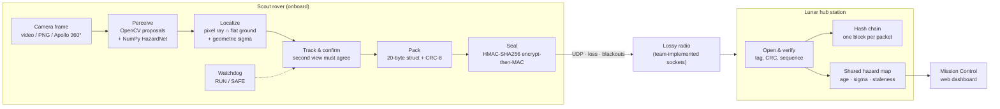

# VEIL — Project C.R.A.T.E.R.

**ATEC'26 · Constrained Reconnaissance, Autonomy & Telemetry in Extreme Regions**

VEIL is a fully software-emulated lunar scout. It looks at the Moon through an onboard camera, finds rocks and pits with a small AI model running on the rover, turns each detection into meters on the ground, packs it into a **20-byte** radio packet, seals it, and sends it over a lossy link to the **lunar hub station**. The hub builds one shared hazard map for every scout and shows it on a live Mission Control dashboard.

The camera picture never leaves the rover. Only the 20-byte packets travel.

| | |
|---|---|
| Hazards found (acceptance run) | **4 / 4**, **0 false** |
| Mean position error | **0.038 m** (worst 0.085 m) |
| Packet size | **20 bytes**, CRC-8 checked |
| Survives packet loss | **30 %** loss with every hazard delivered |
| Smaller than plain JSON | **~15×** (1,600 B against 23,798 B) |
| Onboard speed | **265–510 FPS** on a laptop CPU |
| Dependencies | `numpy`, `opencv-python` |

---

## Architecture



The book fixes the flow **Perception → Telemetry → Dashboard**. VEIL follows it end to end:

| Stage | What happens | Code |
|---|---|---|
| **1 · Perceive** | OpenCV finds dark and bright blobs. A 2-layer NumPy network names each one `rock`, `pit`, `none`, or `artifact` (lens smudge). Runs locally, no cloud. | `veil/veil/perceive.py`, `model.py` |
| **2 · Localize** | Each pixel becomes a ray from a pinhole camera of known mast height and pitch. The ray hits the ground plane `z = 0`, giving x, y in meters from the landing site. Sigma comes from camera geometry. | `veil/veil/camera.py` |
| **3 · Confirm** | A hazard is only sent after a second view places it in the same spot. Tracks that slide between views (the signature of a lens artifact) are rejected. | `veil/veil/tracks.py`, `onboard.py` |
| **4 · Transmit** | Hazards, poses, and heartbeats share one 20-byte layout. A priority queue retries hazards, drops stale poses, and stays quiet during blackouts. | `veil/veil/packet.py`, `link.py`, `procs.py` |
| **5 · Secure** | Every packet is encrypted and signed (45 B on the wire), and the hub appends it to a SHA-256 hash chain so tampering or replay shows. | `veil/veil/seal.py` |
| **6 · Visualize** | The hub map is served to a browser dashboard with data age, uncertainty circles, staleness, link state, and the decoded latest packet. | `veil/veil/mission.py`, `veil/web/index.html` |

### Separate processes

`python run_mission.py` starts **onboard**, **radio**, and **hub** as three OS processes talking over UDP on loopback. The radio process drops packets at the chosen rate and opens blackout windows. `--in-process` keeps everything in one process for demos and tests; the link still uses real UDP sockets.

### The 20-byte packet

Little-endian, `struct` format `<BBHIHBBBhhBBB`:

| Bytes | Field | Notes |
|---|---|---|
| 0 | magic | `0xC7` |
| 1 | version · type | 2-bit version, 6-bit type (hazard / pose / heartbeat) |
| 2–3 | sequence | 16-bit, wrap-safe comparison |
| 4–7 | time | milliseconds |
| 8–9 | track id | |
| 10 | class | 1 = rock, 2 = pit |
| 11 | flags | bit 0 = SAFE mode |
| 12 | agreement | 0–100 % |
| 13–14 | x | signed centimeters |
| 15–16 | y | signed centimeters |
| 17 | sigma | centimeters |
| 18 | radius | centimeters |
| 19 | CRC-8 | polynomial `0x07` |

The sealed envelope is `0xE1 · 8-byte nonce · 20-byte ciphertext · 16-byte tag` = 45 bytes. Full contract: [`veil/docs/TELEMETRY_PROTOCOL.md`](veil/docs/TELEMETRY_PROTOCOL.md).

### Flight-software habits

Bounded queues and per-frame limits, a watchdog that switches to **SAFE** mode when the camera stalls (pose and heartbeat keep flowing, new hazards wait onboard), checksums on every packet, deterministic packet logs across process runs, and a hard failure when model weights are missing. See [`veil/docs/FLIGHT_SOFTWARE_PRINCIPLES.md`](veil/docs/FLIGHT_SOFTWARE_PRINCIPLES.md).

---

## Technologies

| Area | Choice | Why |
|---|---|---|
| Language | **Python 3.13** | One language from camera to dashboard |
| Vision | **OpenCV** | Fast classical proposals on constrained compute |
| AI model | **NumPy** 2-layer MLP (262 → 64 → 4) | ~73 KB of weights, no GPU, no framework, runs at hundreds of FPS |
| Spatial math | Pinhole camera, ray–plane intersection | Closed form, defensible, testable against ground truth |
| Serialization | Python `struct`, CRC-8 | Fixed 20-byte binary layout |
| Transport | UDP sockets, team-written loss and blackout emulation | Matches a degraded radio link |
| Security | `hmac` + `hashlib` (HMAC-SHA256, SHA-256 chain) | Standard library only |
| Dashboard | Plain **HTML / Canvas / JavaScript**, served by Python `http.server` | Zero build step, works offline |
| Tests | **pytest** + acceptance scenarios | Automated test outputs for preselection |

---

## Run it

### Setup

```bash
git clone https://github.com/AHmedHsini/atec.git
cd atec/veil
python -m venv .venv
.venv\Scripts\activate          # macOS / Linux: source .venv/bin/activate
pip install -r requirements.txt
```

### Live dashboard

```bash
python run_mission.py
```

Open **http://127.0.0.1:8877**. This is the scripted crater mission: three processes, 30 % packet loss, a blackout window, and the encrypted chain. `Ctrl+C` stops it.

**Apollo 11 360° panorama**, with a real lunar photo you can turn:

```bash
python run_mission.py --panorama --in-process --loss 0
```

Drag the photo or use **← →** to turn the camera. Every new heading is a new camera frame run through the PolarDB model. The white lines are meters ahead of the lens; zoom in for 1 m lines.

Other modes:

| Command | What it shows |
|---|---|
| `python run_mission.py --polar` | PolarDB lunar-analog frames with the PolarDB network |
| `python run_mission.py --source path/to/frames_or.mp4` | Your own video or PNG folder |
| `python run_mission.py --loss 0.5` | Harsher radio |
| `python -m veil.ingest video.mp4` | Play a clip with no pose file |

### Tests and acceptance

```bash
python -m pytest tests -q        # 52 unit tests
python -m veil.accept            # full acceptance suite, writes artifacts/acceptance/*.json
python -m veil.verify            # tests + acceptance + bench + geometry + robustness + ablation
```

Acceptance checks every scenario for 4/4 hazards, 0 false hazards, at least one rejected lens track, mean error under 0.25 m, exact byte accounting, a loss sweep from 10 % to 90 %, blackout recovery, and identical packet logs across separate processes. How to read the output: [`veil/docs/TESTING_AND_ACCEPTANCE.md`](veil/docs/TESTING_AND_ACCEPTANCE.md).

---

## How we trained the model

VEIL ships **one architecture with two sets of weights**. Both are trained from scratch and run through the same NumPy inference code.

### The network

- **Input:** a 262-number vector per candidate blob: a 16 × 16 grayscale patch (256 values) plus 6 summary values: mean, contrast, dark fraction, bright fraction, and the normalized pixel position u, v.
- **Layers:** 262 → 64 (ReLU) → 4 (softmax). Classes: `none`, `rock`, `pit`, `artifact`.
- **Training (`veil.model.train`):** mini-batch SGD, batch 64, 48 epochs, learning rate 0.08 decaying 4 % per epoch, He initialization, per-feature standardization saved with the weights.
- **Size:** about 73 KB per `.npz` file.

### 1 · Mission weights: `veil/outputs/hazard_net.npz`

Trained on rendered crater frames from the onboard simulator.

```bash
cd veil
python -m veil.train
```

- 280 frames from random scout poses, with 2–4 random rocks and pits per frame plus the four flight hazards every fourth frame.
- Brightness gain (0.72–1.28) and bias (±18) augmentation.
- Lens-artifact samples (a dark disk painted on the lens) so the network learns to say “artifact” instead of “rock.”
- Balanced to 318 samples per class (1,272 total).
- **Held-out accuracy: 0.90** on a separate seed. All four flight hazards are named correctly in every frame they appear (169 of 169).

These weights drive the acceptance mission, so the graded 4/4-hazard result is reproducible.

### 2 · Lunar-analog weights: `veil/outputs/hazard_net_polar.npz`

Trained on **NASA POLAR Stereo Dataset** imagery: photographs of lunar-analog terrain under polar lighting, with laser range maps as ground truth.

- **Data:** 12 terrains (~11.7 GB of zips), placed in `dataset/polar/` (git-ignored).
- **Labels come from 3D ground truth, not hand drawing.** For each rectified frame, the range map gives every pixel a height relative to a fitted ground plane:
  - **rock:** local height above the surrounding ground > 2.5 cm
  - **pit:** local depression > 2.8 cm, or more than 5.5 cm below the plane (craters)
  - **none:** flat within 1 cm locally and 2.2 cm overall
  - **artifact:** synthetic lens smudges (PolarDB has none)
- **Patches:** frames are stereo-rectified, tone-mapped to 8-bit at native 1936 × 1216, then a 64 × 64 window is shrunk to 16 × 16 so the same 262-number recipe sees a whole rock.
- **Honest split:** Terrains **9 and 12 are fully held out**, plus about 25 % of frames from every other terrain chosen by file-path hash. 266 training frames, 166 validation frames.
- **Balanced:** 1,200 per class for training (4,800 total), 240 per class for validation (960 total).
- **Held-out accuracy: 0.581** on frames and terrains the model never saw. Artifacts are almost always caught (211 / 240). Most confusion is rock vs. pit vs. flat ground on real photos. Full confusion matrix: `veil/outputs/polar_train_report.json`.

Patch extraction and labeling live in `veil/veil/polar.py` (`generate_polar`). Because of the dataset size, the arrays were fitted to the same 262 → 64 → 4 network in a cloud session. The resulting weights and the full report are committed.

Both numbers stay labeled with their dataset on the dashboard: **0.9 is synthetic, 0.581 is PolarDB.**

---

## Data and credits

- **Apollo 11 panorama:** NASA, via Wikimedia Commons (`Apollo_11_Panorama_Station_2.jpg`), in `dataset/panorama/`. Collection also at [USGS Astrogeology](https://astrogeology.usgs.gov/search/map/moon-apollo-landing-panoramas).
- **Lunar surface backdrop:** LROC image of Tsander crater, NASA / GSFC / Arizona State University.
- **POLAR Stereo Dataset:** NASA Ames Intelligent Robotics Group.

## Known limits

- The ground is treated as flat. Rocks on a hillside or far up a slope land past their real position; marks beyond 20 m are labeled “far.”
- Panorama distances use an estimated camera height and tilt for a 1969 hand-held camera. A check against the Apollo 11 flag gets the right shape with a remaining size error of about a third.
- The encryption key is pre-shared and fixed for the demo.

Full list: [`veil/docs/LIMITATIONS.md`](veil/docs/LIMITATIONS.md).

## Repository layout

```
veil/
  run_mission.py        start the mission and dashboard
  veil/                 flight code: perceive, camera, tracks, onboard, packet, link, seal, procs, mission
  web/index.html        Mission Control dashboard
  tests/                pytest suite
  outputs/              model weights and training reports
  artifacts/            acceptance, bench, geometry, robustness outputs
  docs/                 architecture, protocol, testing, limitations
dataset/
  panorama/             Apollo 11 360° strip
  surface/              Apollo surface still with camera.json
crater/                 earlier prototype, kept for history
```

## Team

**Ahmed**, **Wissal**, **Hammoud** · ATEC'26 at ESPRIT
