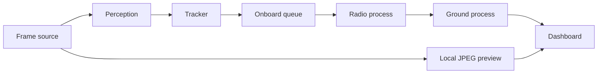

# Architecture

The JPEG preview is drawn on the scout and shown by the dashboard. It is not a packet and it is not radioed.

## Roles

`python run_mission.py` starts onboard, radio, and ground as three operating-system processes. The parent serves the dashboard and stops the children on Ctrl-C. Sockets are UDP on 127.0.0.1. The radio process applies loss. The onboard process holds packets while the blackout window says the link is down. `run(..., processes=False)` and `--in-process` keep the fast single-process path used by most tests. One acceptance scenario uses the three processes.

Perception reads a `FrameSource`. `SimFrameSource` paints the drive. `VideoFrameSource` reads a PNG directory or an mp4. If `poses.csv` or `{stem}_poses.csv` is missing, the scout assumes constant forward speed and the report says `pose source: assumed constant velocity`. `camera.json` can override mast height, pitch, and intrinsics. A frame of another size is scaled onto the 320×240 flight image and the intrinsics are scaled with it.

Blob radius uses pinhole depth along the optical axis: `radius_m = depth_cam * radius_px / fx`. The older flat-range formula `distance * radius_px / fx` is compared in `python -m veil.validate_geometry`. The flight path keeps the depth form when that comparison is smaller or equal.

| Piece | File | Owns |
| --- | --- | --- |
| Camera | `veil/camera.py`, `veil/source.py` | Mast model, ground intersection, frame source |
| World | `veil/sim.py` | Synthetic image and known hazards |
| See | `veil/perceive.py`, `veil/model.py` | Proposals and local network |
| Hold | `veil/tracks.py` | Agreement across motion |
| Send | `veil/onboard.py`, `veil/packet.py` | 20-byte queue, heartbeat, watchdog |
| Radio | `veil/link.py`, `veil/procs.py` | UDP, loss, blackout, acks, process split |
| Map | `veil/ground.py` | Accepted fixes, heartbeat link state |
| Screen | `veil/web/index.html` | Map, age, sigma, local preview |

`veil/mission.py` is the pipeline. `run(processes=True)` delegates to `veil/procs.py`. Tests and `python run_mission.py` both call `run()`.

## Coordinates

World origin is the landing site. +X is right, +Y is forward, +Z is up. Units are meters. The ground used for localization is z = 0.

The camera is at `(scout_x, scout_y, 0.55)`. Yaw 0 points along +Y. Positive yaw turns toward +X. The mast is pitched 18° down. Image u grows right, v grows down. The principal point is (160, 120). Focal length is 300 pixels on both axes.

A world point is moved into the camera basis `(right, down, forward)`. Pixel `(u, v)` is `fx * x_cam / z_cam + cx`. The inverse builds the same direction and intersects z = 0. Rays with a non-negative vertical component, a non-positive range, or a non-finite input return no hit. Points behind the scout have negative camera-forward depth and are not turned into map points.

The dashboard wedge is `view_polygon`, the same four rays as the picture, yaw locked to 0.

## Tracking

A detection associates to a same-class track within 0.55 m. After the scout has traveled 0.7 m, the window of points must lie within 0.32 m of their median or the track is `rejected` with reason `inconsistent_ground`. A tight window is `confirmed`. A track that disappears for more than 6 frames before that judgment is `expired` with reason `missed_detections`. Confirmed rock and pit tracks are queued. Artifact and rejected tracks are not.

The lens spot is fixed in the image, so its ground point slides with the scout. The spread exceeds 0.32 m. A temporary pit label does not confirm it, because confirmation is geometric.

## Radio and map

While the link is open, each send still fails with the configured probability (default 0.3) using a seeded generator. A blackout sends nothing. After the live drive, the radio also closes for 4 s of every 14 s.

The radio listener checks CRC-8 (polynomial 0x07) and protocol version 1 before an ack. Sequence order on the ground uses 16-bit serial arithmetic, so a counter that wraps from 65535 to 0 is still newer.

If the link is down and the newest pose is at most 1.2 s old, the scout mark is coasted with the last velocity and flagged predicted. After 1.2 s the mark stays on the last accepted pose and stays flagged predicted. Hazard sigma grows by 0.05 m per second of silence since that hazard's timestamp. Age is `sim_t - t_ms` in seconds.

## Flight software

The onboard queue holds at most 8 packets. Overflow drops the lowest value. Hazards outrank poses, and poses outrank heartbeats. A hazard that is still queued after 12 send attempts, or older than the pending limit (30 s, or 8 s in the stress case), is counted lost.

A type-3 heartbeat carries mode, queue depth, uptime, and the confirmed count. The ground calls the link UP, DEGRADED, or DOWN from the age of that heartbeat (under 1 s, under 3 s, otherwise DOWN).

If perception does not run for more than 1 simulated second, the mode becomes SAFE: heartbeats continue, and new hazards are not confirmed onto the queue. The next frame of perception returns to RUN.

The same seed produces a byte-identical packet log in one process. Across processes, with loss 0 and a short wait for the ack, the log is also byte-identical. The log is hex lines in `artifacts/acceptance/`.

## Shutdown

`run` closes the link sockets and joins the listener, and shuts down the HTTP server if it started one. The process launcher sets a stop event, joins the children, and terminates any that remain. The server does not set `allow_reuse_address`, so a second live process fails instead of hiding behind the first one.
